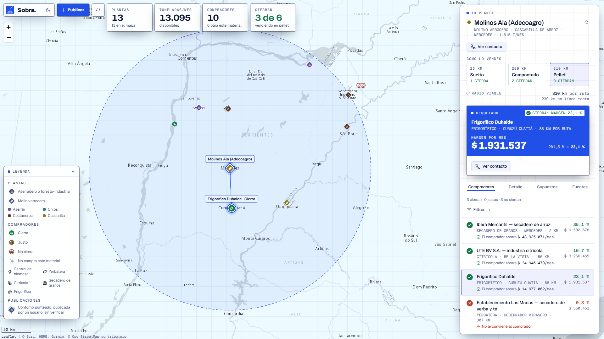

<div align="center">

<picture>
  <source media="(prefers-color-scheme: dark)" srcset="docs/images/logo-dark.svg">
  
</picture>

### ¿Cierra el negocio?

Un mapa de Corrientes donde quien genera residuos de madera o arroz y quien puede usarlos se encuentran,<br>
y cada match dice si vender cierra después de pagar el flete.

**[Ver demo →](https://ideathon-agro-9u3t-flax.vercel.app/)**

</div>

<p align="center">
  <picture>
    <source media="(prefers-color-scheme: dark)" srcset="docs/images/app-dark.png">
    
  </picture>
</p>

## De qué se trata

Proyecto para la Ideathon Agro, Desafío 03 · *Del subproducto al mercado*. Conecta en un mapa a quienes generan cascarilla de arroz o biomasa forestal con quienes pueden usarla como combustible, y calcula si la venta deja margen después del flete, según el material vaya suelto, compactado o en pellet.

## Tecnologías

- **Web:** Vite, React 19, TypeScript, Tailwind CSS 4, shadcn, Leaflet
- **API:** Hono sobre Cloudflare Workers
- **Base (opcional):** PostgreSQL + Drizzle ORM
- **Tests:** Vitest y Playwright

Monorepo con npm workspaces: `apps/web`, `apps/api`, `packages/core` (dominio) y `packages/db`.

## Cómo levantarlo

Requisitos: Node 22 o superior y npm.

```bash
npm install
npm run dev
```

- Web: http://localhost:5173
- API: http://localhost:8787

No hace falta base de datos: sin `DATABASE_URL` la API usa los datos incluidos en el repo. Para usar Postgres, ver [packages/db/README.md](packages/db/README.md).

## Licencia

[MIT](LICENSE) © 2026 Equipo Circular NEA
